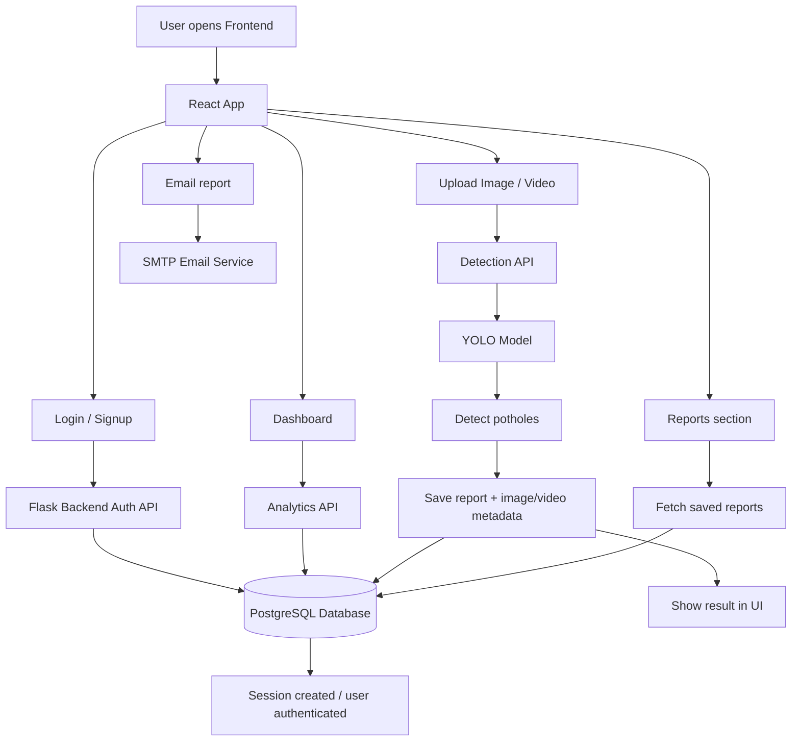

# Fix My City - Pothole Detection System

This project is a full-stack pothole detection and reporting application built with Flask (backend), React + Vite (frontend), PostgreSQL database, and YOLO-based image/video analysis.

## Live Deployment

- Frontend: https://pothole-detection-2-sc8w.onrender.com
- Backend API: https://pothole-detection-1-2csi.onrender.com

## Important Note

Detection may be slow or may not work properly on low-memory hosting environments such as the free Render plan because the YOLO model is heavy and runs on CPU. The model loading and inference require significant memory and processing power. For better detection performance, use a higher-memory deployment plan or a lighter ONNX model.


## Note

This application is designed to run as a production deployment on Render with:

- Frontend hosted on Render Static Site
- Backend hosted on Render Web Service
- PostgreSQL database for reports and user authentication
- Cookies enabled for cross-site session authentication between the frontend and backend

The app includes:
- User login and signup
- Dashboard analytics
- Image upload detection
- Video upload detection
- Camera/live detection
- Report saving and viewing
- Email reporting support

## System Flow



## Working Flow

1. User opens the frontend.
2. Frontend calls the backend `/login` or `/register` endpoint.
3. Flask validates credentials and creates a session cookie.
4. The session is used for protected routes such as:
   - `/api/session`
   - `/api/dashboard/analytics`
   - `/upload-image`
   - `/upload-video`
   - `/detect-frame`
5. If the user uploads an image/video, the backend runs YOLO inference.
6. Detected potholes are saved in the database and report files are stored.
7. Analytics and reports are fetched from the PostgreSQL DB and displayed on the dashboard.

## Project Architecture

### Frontend
- React app with Vite
- UI for login, dashboard, reports, image/video upload, and camera detection
- File location: `frontend/`

### Backend
- Flask API server
- User authentication, session management, analytics, routes, and YOLO processing
- File location: `backend/`

### Database
- PostgreSQL in production
- SQLite fallback for local development
- Tables include users and reports

## Main Backend Endpoints

- `GET /api/health` - Health check
- `POST /login` - Login
- `POST /register` - Register user
- `GET /api/session` - Session status
- `POST /logout` - Logout
- `GET /api/dashboard/analytics` - Dashboard analytics
- `POST /upload-image` - Upload and analyze image
- `POST /upload-video` - Upload and analyze video
- `POST /detect-frame` - Detect potholes from camera frame
- `GET /reports` - View reports
- `GET /reports-stats` - Report statistics

## Tech Stack

- Python
- Flask
- React
- Vite
- PostgreSQL
- YOLO / Ultralytics
- OpenCV
- Gunicorn
- Render Deployment

## Local Setup

### 1. Clone the project

```bash
git clone <repository-url>
cd minor
```

### 2. Create Python environment

```bash
python -m venv .venv
.venv\Scripts\activate
pip install -r requirements.txt
```

### 3. Run backend

```bash
cd backend
python app.py
```

### 4. Run frontend

```bash
cd frontend
npm install
npm run dev
```

## Production Notes

- Use Render environment variables for:
  - `DATABASE_URL`
  - `SECRET_KEY`
  - `FRONTEND_URL`
  - `CORS_ORIGINS`
  - `SMTP_SERVER`
  - `SMTP_PORT`
  - `SMTP_EMAIL`
  - `SMTP_APP_PASSWORD`
  - `SMTP_USE_STARTTLS`
- Ensure frontend and backend cookies are configured for cross-site HTTPS usage.
- Use one Gunicorn worker on low-memory render plans for better stability with YOLO inference.

## Important Note

Detection may be slow or may not work properly on low-memory hosting environments such as the free Render plan because the YOLO model is heavy and runs on CPU. The model loading and inference require significant memory and processing power. For better detection performance, use a higher-memory deployment plan or a lighter ONNX model.

## Project Structure

```text
minor/
├── README.md
├── app.py
├── backend/
│   ├── app.py
│   ├── config.py
│   ├── database.py
│   ├── auth_utils.py
│   ├── process/
│   ├── routes/
│   ├── gunicorn.conf.py
│   └── requirements or config files
├── frontend/
│   ├── src/
│   ├── package.json
│   └── vite.config.js
├── render.yaml
├── requirements.txt
├── best.pt
├── static/
├── templates/
└── ...
```

## Summary

This system allows users to log in, upload road images or videos, detect potholes using YOLO, save reports, view analytics, and monitor road issues through a clean dashboard. It is designed for production deployment with Render and PostgreSQL and is currently deployed with the public frontend and backend links above.
